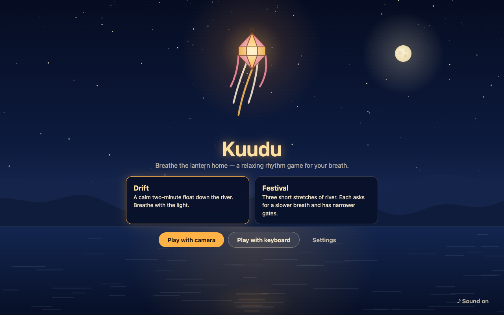
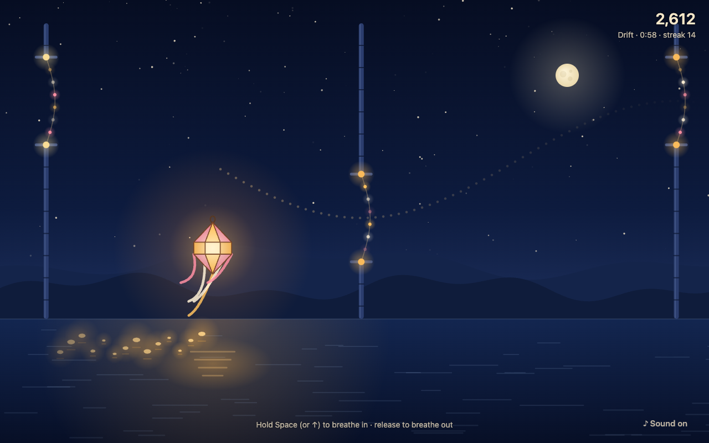

# Kuudu: Breathe the Lantern Home

A relaxing rhythm game where you guide a glowing paper lantern down a night river with your breath.

Breathe in and the lantern rises. Breathe out and it drifts down. Follow the slow wave of the river
to float through the festival gates, and the water lights up behind you.

The game is inspired by the _kuudu_, the paper lanterns of Vesak in Sri Lanka, under a full Poya
moon. All artwork and sound are original and generated in code.

Built for the [Presage SmartSpectra SDK Challenge](https://dev.to/challenges/presage-2026-11-04)
with Electron and the [SmartSpectra Node SDK](https://github.com/Presage-Security/SmartSpectra).

> **Demo video:** _coming soon_





## Get started

You need Node.js 24+, a webcam, and a free SmartSpectra API key.

1. Get a free API key at [physiology.presagetech.com](https://physiology.presagetech.com).
2. Install and add the key to a `.env` file in the project folder:

   ```bash
   git clone https://github.com/dhananjaya-hbc/Kuudu-Breathe-the-Lantern-Home.git
   cd Kuudu-Breathe-the-Lantern-Home
   npm install
   cp .env.example .env
   # then edit .env: SMARTSPECTRA_API_KEY=your-key
   ```

3. Run `npm run dev` and choose **Play with camera**.
4. Read the consent screen and press **Start camera**. Allow camera access if your system asks.
5. Breathe naturally for a few seconds while the signal settles (up to 30 s), then follow the
   blue light for about 19 seconds to calibrate, and breathe the lantern home.

For the best signal, sit about an arm's length from the camera in even, front-facing light, with
your shoulders and chest in view. A small mirrored preview (top left) shows what the camera sees,
so you can check your framing. The game shows a hint and pauses if it can't see you clearly.

**Controls:** **Esc** or the **Stop** button turns the camera off at any time · **V** hides or
shows the camera preview · **M** mutes sound · **D** shows the live waveform and debug stats.

## How to play

- **Drift**: a calm two-minute run at 7.5 breaths per minute with wide gates.
- **Festival**: three one-minute levels. Each one asks for a slower breath (7.5 → 6.5 → 6
  breaths per minute) and has narrower gates.

A dotted path shows the wave ahead. Gates sit on its peaks (breathe in) and troughs (breathe out).
Matching the wave makes the lantern **glow** and earns points. Each gate in a row adds a light to
the river and a bigger bonus. Jerky breathing, or holding your breath while the wave moves, makes
the lantern **flicker**.

At the end, the camera turns off and the lantern floats away. Your whole run is drawn across the
sky as a ribbon, over the target wave, with your score, rhythm match and breathing pace.

## How Kuudu uses SmartSpectra

Breath is the game controller, so the signal is used live, not as a summary.

| SmartSpectra output                                                       | How Kuudu uses it                                                                                                                                                   |
| ------------------------------------------------------------------------- | ------------------------------------------------------------------------------------------------------------------------------------------------------------------- |
| `breathing.upperTrace`, the chest movement waveform, ~30 samples a second | Moves the lantern on every frame. It is drift-corrected, scaled to the player, smoothed, and eased to 60 fps ([`signal.ts`](src/renderer/signal.ts)).               |
| `breathing.rate`, with confidence                                         | The **pace** on the end screen, averaged from readings with confidence ≥ 45 (the SDK's reliability threshold).                                                      |
| `validationStatus` codes                                                  | Friendly hints such as "Move a little closer" or "Find a little more light", which pause the game until the view is clear ([`hints.ts`](src/renderer/ui/hints.ts)). |
| `error` codes                                                             | Plain-language messages, for example when the free-trial limit is reached.                                                                                          |

Only these two metrics are requested. SDK telemetry is turned off.

Presage notes that the breathing waveform needs up to 30 seconds to become reliable, so each
camera run starts with a short **settling-in** step. It ends when the SDK marks the signal stable
(or after 30 s). Then a **guided calibration** (two slow breaths following a light) measures
the direction of the signal, the player's breath size, and the end-to-end delay. Scoring is shifted
by that delay, so signal lag never counts against the player ([`calibration.ts`](src/renderer/calibration.ts)).

The breathing-rate value is a ~30-second average, so it can't steer a game. That is why the lantern
follows the raw chest waveform instead. The waveform's `stable` flag follows the rate's
confidence, which drops whenever the player changes pace, so the lantern does not wait for it.

## Privacy and consent

- The camera stays **off** until you press **Start camera** on the consent screen.
- A **"Camera on"** badge shows whenever it is on. **Stop** or **Esc** turns it off at any time.
  It also turns off at the end of every run and when the app closes.
- Breathing is measured **on your computer** by the SmartSpectra SDK. The SDK connects to Presage
  to check the API key and usage. **SDK telemetry is turned off.**
- **Video and images are never recorded or saved.** Breathing data stays in memory during a run
  and is discarded afterwards.
- The **only** thing saved is your best score and its date for each mode, on your computer.
  **Settings → Reset data** deletes it.
- No accounts, analytics, ads, or AI services.

Full details: [docs/consent-and-data.md](docs/consent-and-data.md).

## Not a medical device

Kuudu is a relaxing rhythm game. It does not diagnose, treat or monitor any condition, and its
readings are used for gameplay only.

## Requirements

- **Node.js 24** (LTS) or newer.
- **macOS on Apple Silicon**, **Windows x64**, or **Linux x64/ARM64** with glibc 2.35+ (Ubuntu
  22.04+). These are the platforms the SmartSpectra Node SDK supports. Kuudu has been developed
  and tested on macOS (Apple Silicon).
- A webcam.

## Development

```bash
npm run dev        # run the app with hot reload
npm test           # unit tests (signal, calibration, gates, scoring, modes, storage)
npm run typecheck  # TypeScript
npm run lint       # ESLint
npm run build      # production build into out/
```

### Project layout

```
src/
  main/index.ts            Electron main: window, SDK IPC bridge, camera-only permissions, API key
  preload/index.ts         SDK preload bridge + getApiKey() for the renderer
  shared/api.ts            IPC contract
  renderer/
    main.ts                screens and game flow
    sdk.ts                 SmartSpectra camera input
    signal.ts              waveform → smooth 0–1 lantern height
    calibration.ts         guided calibration: direction, breath size, delay
    rhythm.ts              guide wave and match maths
    game/                  loop, scene, lantern, gates, target wave, scoring, modes
    audio/ambient.ts       generated ambient sound
    ui/                    consent, camera badge, hints, settings, end screen
    storage.ts             local high scores (the only saved data)
tests/                     Vitest unit tests
```

### Security notes

- The API key is read from `.env` by the main process only. The renderer asks for it at runtime
  through a private IPC call. It is never bundled into app code or committed (`.env` is in
  `.gitignore`).
- The renderer is sandboxed and context-isolated, with a strict Content Security Policy. It can't
  navigate away or open windows. Only the camera is permitted (no microphone), and only for the
  app's own page.

## Troubleshooting

- **`npm install` is slow.** The SDK ships a native runtime for every supported platform, about
  550 MB in total. On a slow connection this can take a while.
- **`Error: Electron uninstall` on `npm run dev`.** Electron's binary download was interrupted.
  Run `npm rebuild electron`, or delete `node_modules/electron` and run `npm install` again.
- **No window opens, or Electron acts like plain Node.** Your shell may have
  `ELECTRON_RUN_AS_NODE=1` set (some editors do this). Run `unset ELECTRON_RUN_AS_NODE`, then
  `npm run dev`.
- **The camera is blocked on macOS.** Allow camera access for Electron, or for your terminal or
  editor, in System Settings → Privacy & Security → Camera.
- **"The SmartSpectra API key was not accepted."** Check the key in `.env`, then restart the app.
- **"Free-trial usage limit has been reached."** The API key's free-trial usage is used up. Ask
  on the Presage Discord, or use another key.

## License

MIT for this project's code (see [LICENSE](LICENSE)). The SmartSpectra SDK is distributed by
Presage Technologies under its own license.
